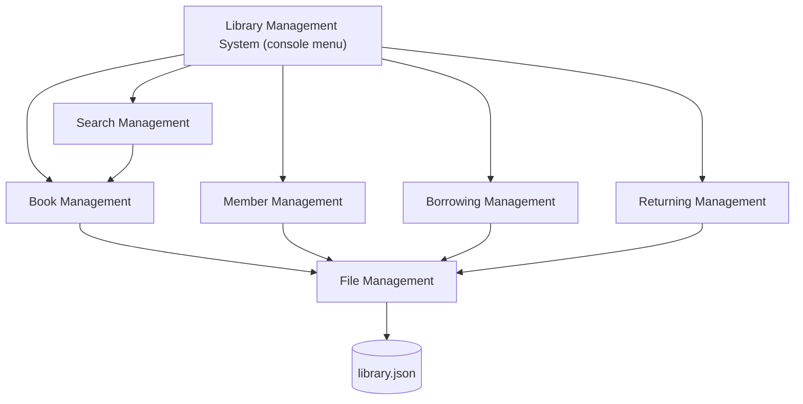

# Library Management System

A console application written in C# (.NET 8) that manages books and members, issues and returns loans, and keeps everything in a JSON file so data survives restarts. It is built as a system programming case study: file handling, resource management, exception handling, and running as an operating system process.

Written and tested for Linux (developed with Parrot OS in mind). It also runs on Windows and macOS.

## Features

- Add books and list them
- Register members
- Borrow and return books, with a 14-day loan period and a limit of 5 loans per member
- Overdue days reported on return
- Find a book by ID, or search by title, author or ISBN
- Data stored permanently in a JSON file, written safely so a crash cannot corrupt it
- Clear error messages instead of crashes for bad input and file problems

## Architecture



| Layer | Code | Role |
|---|---|---|
| Console | `Services/ConsoleMenu.cs` | Reads input, prints results, catches errors |
| Business rules | `Services/LibraryService.cs` | Books, members, loans, search |
| Storage | `Storage/JsonFileLibraryStore.cs` | Reads and writes the data file |
| Models | `Models/` | `Book`, `Member`, `LibraryData`, `ReturnReceipt` |

The service depends on the `ILibraryStore` interface, not on the file. That is what lets the tests run without touching the disk, and what would let you swap in a database later.

## Quick start (Linux / Parrot OS)

Install .NET 8 first. Step-by-step instructions are in [docs/SETUP_PARROT_OS.md](docs/SETUP_PARROT_OS.md).

```bash
git clone git@github.com:YOUR-USERNAME/library-management-system.git
cd library-management-system
dotnet run --project src/LibraryManagement
```

Replace `YOUR-USERNAME` with your GitHub username.

## Usage

```text
1) Add book        5) Borrow book
2) List books      6) Return book
3) Add member      7) Find book by ID
4) List members    8) Search books
0) Exit
```

A short session:

```text
Choose an option: 1
Title: Clean Code
Author: Robert C. Martin
ISBN (optional): 9780132350884
Book saved successfully with ID 1.
Choose an option: 3
Name: Amina Otieno
Email: amina@example.com
Member registered with ID 1.
Choose an option: 5
Book ID: 1
Member ID: 1
'Clean Code' is now borrowed. Due 2026-12-06.
```

### Where data is stored

| Order | Source |
|---|---|
| 1 | `--data <file>` command-line option |
| 2 | `LIBRARY_DATA_FILE` environment variable |
| 3 | `~/.local/share/library-management/library.json` on Linux |

```bash
dotnet run --project src/LibraryManagement -- --data ./my-library.json
```

### Exit codes

| Code | Meaning |
|---|---|
| 0 | Normal exit |
| 1 | Unexpected error |
| 2 | Data file could not be read or written |
| 64 | Bad command-line usage |

## Tests

```bash
dotnet test
```

The tests cover adding, listing, borrowing, returning, invalid IDs, restarting the application, a corrupt data file, and a failed save. The mapping to the case study test table is in [docs/CASE_STUDY.md](docs/CASE_STUDY.md).

## Project layout

```text
.
├── src/LibraryManagement/        application code
│   ├── Models/
│   ├── Services/
│   ├── Storage/
│   ├── Exceptions/
│   └── Program.cs
├── tests/LibraryManagement.Tests/
├── docs/
│   ├── CASE_STUDY.md
│   ├── SETUP_PARROT_OS.md
│   └── GITHUB_HOSTING.md
├── .github/workflows/            CI build and tagged releases
└── LibraryManagement.sln
```

## Publishing a release

Push a version tag and GitHub Actions builds single-file executables for Linux and Windows and attaches them to a GitHub Release. See [docs/GITHUB_HOSTING.md](docs/GITHUB_HOSTING.md).

## Known limitations

- One user at a time. Two copies of the program writing the same file can overwrite each other's changes.
- All records are loaded into memory. This is comfortable for thousands of books, not millions.
- No authentication and no fines beyond reporting overdue days.

## License

MIT. See [LICENSE](LICENSE).
