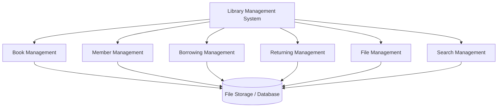

# Case Study: Library Management System Using C#

A console application that demonstrates file handling, resource management, exception handling and process execution on Linux.

## 1. Abstract

This case study describes the design and implementation of a library management system written in C# on .NET 8. The program lets library staff store book records, register members, issue and return books, and search the catalogue. Records are kept permanently in a JSON file, so data survives restarts. The study uses the project to demonstrate system programming concepts: file handling, memory management, input and output, exception handling, data structures, process execution and resource management.

## 2. Problem Statement

A small library keeps its book list in a notebook or spreadsheet. Staff cannot quickly see whether a book is on the shelf, loans are not recorded consistently, and a lost or damaged file means lost records. The library needs a simple program that records books, members and loans, remembers them between sessions, and does not crash when someone types the wrong thing.

## 3. Objectives

The system aims to:

1. Store and manage book records.
2. Register library members.
3. Issue books to members.
4. Record returned books.
5. Search for books.
6. Store information permanently using file handling.
7. Manage errors and exceptions.

## 4. System Overview

### 4.1 Structure



### 4.2 Modules and where they live in the code

| Module | Responsibility | Code |
|---|---|---|
| Book Management | Add books, list books, look up by ID | `LibraryService.AddBook`, `GetBook`, `Books` |
| Member Management | Register and list members | `LibraryService.RegisterMember`, `Members` |
| Borrowing Management | Issue a book, enforce limits, set due date | `LibraryService.Borrow` |
| Returning Management | Record a return, report overdue days | `LibraryService.Return` |
| Search Management | Find books by ID or by title, author, ISBN | `LibraryService.GetBook`, `Search` |
| File Management | Load and save records, protect against corruption | `JsonFileLibraryStore` |
| User interface | Menu, prompts, error display | `ConsoleMenu`, `Program` |

### 4.3 Business rules

| Rule | Value |
|---|---|
| Loan period | 14 days |
| Maximum loans per member | 5 |
| A borrowed book | Cannot be borrowed again until returned |
| ISBN and member email | Must be unique when provided |
| Title, author, name, email | Must not be blank |

## 5. System Programming Concepts Demonstrated

| Concept | Application in the system |
|---|---|
| File handling | Reading and writing book records to a JSON file through `FileStream` |
| Memory management | Storing book objects in a list in memory |
| Input/output | Accepting user input and displaying results |
| Exception handling | Handling invalid input and file errors |
| Data structures | Using `List<Book>` |
| Process execution | Running the application as a process |
| Resource management | Using `using` to close file resources |

### 5.1 What each concept means in this code

**File handling.** `JsonFileLibraryStore.Save` does not overwrite the data file directly. It writes a temporary file, forces the bytes to disk with `Flush(flushToDisk: true)`, then replaces the old file with `File.Move(..., overwrite: true)`. If the program is killed or the power fails during the write, the previous complete file is still there. A plain overwrite could leave a half-written file and lose the whole library.

**Memory management.** C# manages memory with a garbage collector, so the program never frees memory by hand. On startup all records are read into a `List<Book>` and `List<Member>` on the managed heap, and every search and listing works on that in-memory copy. This is fast and simple, and it is also the reason the design suits thousands of books rather than millions (see section 10).

**Input/output.** The menu reads from a `TextReader` and writes to a `TextWriter` instead of calling `Console` directly. In normal use these are the keyboard and screen. A file or pipe can also drive the program, which allows scripted runs and automated tests.

**Exception handling.** Two exception types separate two kinds of failure. `LibraryException` means the user did something invalid, such as borrowing a borrowed book, and the menu prints a clear message and continues. `StorageException` means the data file cannot be read or written, and it is reported without crashing. Both wrap lower-level `IOException`, `UnauthorizedAccessException` and `JsonException` so the user never sees a stack trace.

**Data structures.** `List<Book>` holds the catalogue. Lookup by ID scans the list, which is acceptable at this scale. A `Dictionary<int, Book>` would make lookup constant-time if the catalogue grew.

**Process execution.** The program is an operating system process. It reads command-line arguments (`--data`, `--help`), reads an environment variable (`LIBRARY_DATA_FILE`), returns an exit code to the shell (0 success, 1 unexpected error, 2 data file error, 64 bad usage), and handles the interrupt signal from Ctrl+C. Because every completed action is saved immediately, an interrupt loses nothing.

**Resource management.** File handles are operating system resources. `using var stream = File.OpenRead(path)` guarantees the handle is closed when the block ends, even when an exception is thrown. Without it, handles could stay open and block later writes.

## 6. Design

### 6.1 Layers

| Layer | Class | Knows about |
|---|---|---|
| Console | `ConsoleMenu` | `LibraryService` only |
| Business rules | `LibraryService` | `ILibraryStore` (an interface) |
| Storage | `JsonFileLibraryStore` | The file system |

Dependencies point one way. The business rules never mention files, which is why they can be tested without a disk and why the storage could be replaced later.

### 6.2 Data stored

The file holds one JSON document:

```json
{
  "Version": 1,
  "Books": [
    {
      "Id": 1,
      "Title": "Clean Code",
      "Author": "Robert C. Martin",
      "Isbn": "9780132350884",
      "Status": "Borrowed",
      "BorrowedByMemberId": 1,
      "DueOn": "2026-12-06"
    }
  ],
  "Members": [
    { "Id": 1, "Name": "Amina Otieno", "Email": "amina@example.com" }
  ]
}
```

The `Version` field exists so a future program version can recognise and upgrade an older file format.

### 6.3 Keeping memory and disk consistent

Every change follows the same pattern: change the object in memory, save the file, and if saving fails, undo the in-memory change.

```csharp
private void Persist(Action rollback)
{
    try { store.Save(data); }
    catch { rollback(); throw; }
}
```

Without the rollback, a failed save would leave the screen saying a book was borrowed while the file still said it was available, and the mismatch would surface after the next restart.

## 7. Implementation Highlights

**Borrowing a book** checks, in order: the book exists, the member exists, the book is available, and the member is under the loan limit. Only then does it change the book's status, assign the member and set the due date.

**Returning a book** compares today's date with the due date and reports the number of days overdue. It then resets the status to Available.

**The clock is injected.** `LibraryService` takes a `TimeProvider`, so tests can set the date and check due dates and overdue counts without waiting two weeks.

**Searching** is case-insensitive and matches the title, author or ISBN. Looking up a single book by ID reports a clear error when the ID does not exist.

## 8. Why Files and Not a Database

A database is not required to meet the objectives, and for a first system programming project a file teaches more. Writing the file yourself exposes the real problems: partial writes, crashes, permissions, and handle cleanup. A database hides them.

### 8.1 Database basics, briefly

| Idea | Plain meaning |
|---|---|
| Database | A program whose whole job is storing and retrieving data safely |
| Table | A grid of rows and columns, like a spreadsheet sheet. Books would be one table, members another |
| Query | A question asked in a language called SQL, such as "all books where author contains Martin" |
| Transaction | A group of changes that all succeed or all fail together. This is what the rollback above imitates by hand |
| SQLite | A database stored in a single file. No server to install. The usual first database |

### 8.2 What this design cannot do that a database can

- Two people using the system at the same time. Two running copies of this program would overwrite each other's changes.
- Handling very large catalogues without loading everything into memory.
- Searching quickly through indexes.

### 8.3 Upgrade path

`LibraryService` depends on `ILibraryStore`, so storage can change without rewriting the rules. Be aware that the current interface loads and saves the whole library at once. A database version would be better served by methods such as `AddBook`, `FindBook` and `MarkBorrowed`, so the interface would change as well. That is a moderate change, not a rewrite, and it is the natural next project.

## 9. Testing

### 9.1 Test plan

| Test | Expected result | Automated test |
|---|---|---|
| Add a new book | Book saved successfully | `Add_new_book_saves_it_with_an_id` |
| Display books | All stored books displayed | `Display_books_returns_every_stored_book` |
| Borrow available book | Status changes to borrowed | `Borrow_available_book_changes_status_to_borrowed` |
| Return borrowed book | Status changes to available | `Return_borrowed_book_changes_status_to_available` |
| Search for invalid ID | Error message displayed | `Search_for_an_invalid_id_reports_an_error` |
| Restart application | Previously saved books loaded | `Restart_application_loads_previously_saved_books` |

Additional tests cover blank titles, duplicate ISBNs, borrowing a borrowed book, the loan limit, an unknown member, overdue days, returning a book that is not borrowed, invalid and duplicate emails, a missing data file, a corrupt data file, a failed save with rollback, and the absence of leftover temporary files.

### 9.2 How to run and record results

```bash
dotnet test --verbosity normal
```

The output lists each test with its result. Take a screenshot of this output for your report, together with a screenshot of the manual run below.

### 9.3 Manual run for the report

Run the program, then work through these steps and capture the terminal:

1. Choose `1`, add a book. Expect "Book saved successfully".
2. Choose `2`. Expect the book in the list with status Available.
3. Choose `3`, register a member.
4. Choose `5`, borrow the book. Expect status Borrowed and a due date.
5. Choose `2`. Expect status Borrowed.
6. Choose `6`, return it. Expect status Available.
7. Choose `7` and enter `999`. Expect "No book with ID 999 exists."
8. Choose `0` to exit, start the program again, choose `2`. Expect the books still listed.

### 9.4 Results to report

Report only what you observed. State the date, the machine, the .NET version (`dotnet --version`) and the number of tests passed. Do not copy figures from other sources.

## 10. Limitations

- Single user. There is no file locking between two running copies.
- All data is held in memory, which limits catalogue size.
- No login, no fines in money, no reservations, no member history.
- The JSON file is readable by anyone with access to the folder. It contains names and emails.
- Tests cover the business rules and the file store. The console menu is verified by hand, not by automated tests.

## 11. Future Work

1. Replace the JSON file with SQLite and measure the difference.
2. Add reservations and a loan history per member.
3. Add monetary fines and a configurable policy file.
4. Add file locking so two copies cannot corrupt each other's data.
5. Build a web or desktop front end over the same `LibraryService`.

## 12. Conclusion

The project meets its seven objectives with a small, readable code base. Its main lesson is that persistence is where real programs fail: the write that is interrupted, the file that is corrupt, the handle that stays open. Treating those cases deliberately, with a safe write, a rollback, typed exceptions and `using` blocks, is what turns a classroom exercise into software that can be trusted with real records.

## Appendix: Running the Project

See `README.md` for commands, `SETUP_PARROT_OS.md` for installing .NET on Parrot OS, and `GITHUB_HOSTING.md` for publishing to GitHub.
